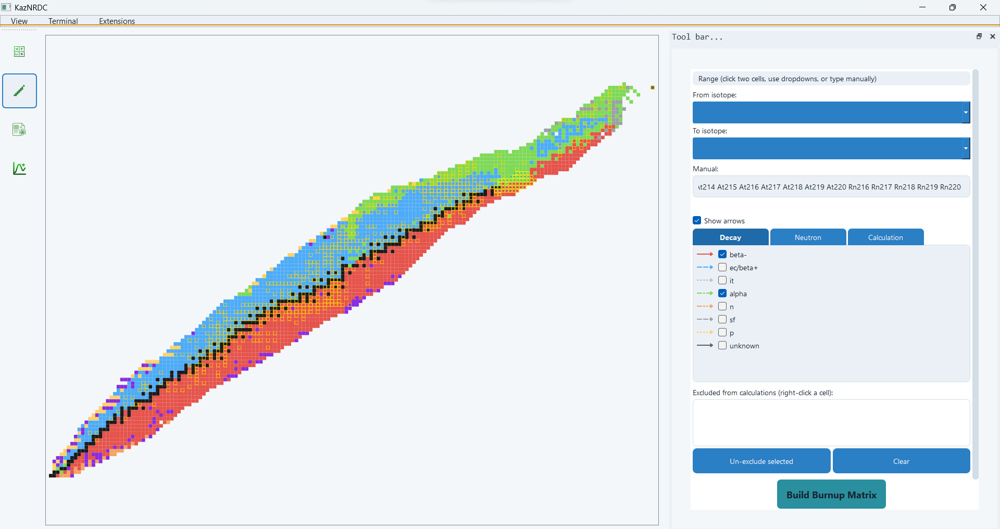

# Network configuration

Selection coordinates use Z and neutron number N = A − Z. The rectangle limit is 5,000 candidate isotopes; practical speed and memory also depend on network connectivity. Manual labels define a selected list; same-element ranges such as `Tl206..Tl216` are supported.

Decay and neutron-channel controls determine which transitions are requested for calculation. Arrow visibility is a display aid. Some stored links can still appear in graph-analysis tools even when filtered out of the matrix.

Right-click exclusion and the excluded-isotope controls modify workspace membership. Reactor mode favors pointwise cross sections; astrophysical mode favors MACS. Missing input can trigger source fallback, so inspect the selected source rather than assuming one library provides every rate.

## Cycle analysis

The cycle tool enumerates elementary closed paths in the stored isotope-link graph. Its iterative depth-first search is bounded by cycle count, length, and time limits; cancellation or a limit can leave a partial list. A missing loop in a truncated search is not proof that it does not exist.

A reported loop describes possible connectivity. Check channel selections, matrix rates, and inventories before interpreting its physical contribution. The GUI enumeration should not be described as a Johnson implementation or assumed to use a separate strongly connected component pass.

## Before building

Record isotope/state membership, energy units, selected libraries, source priority, reaction MT numbers, decay filters, and boundary channels. Build the matrix, then review the resulting list in [Results](results.md). Arrow visibility and plotted isotope filters do not define the same thing as the matrix membership.
