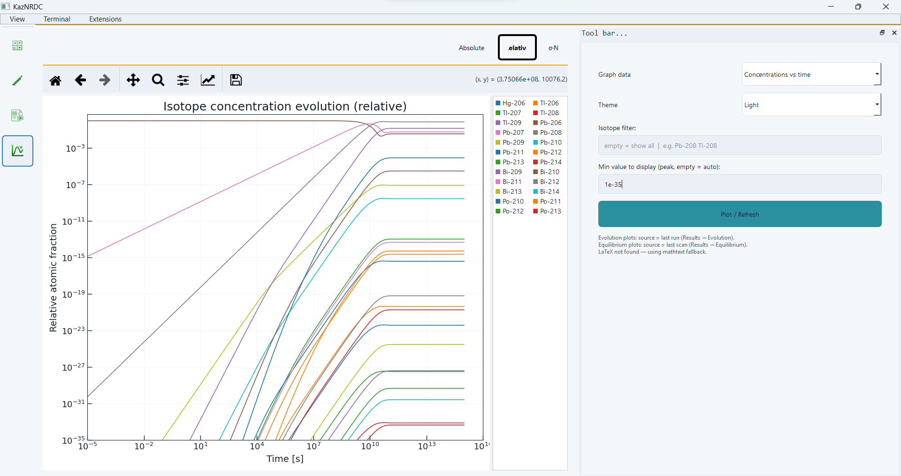

# Plotting workspace

Select a graph type and click **Plot / Refresh**. Use the Matplotlib toolbar for zoom, pan and figure saving. The mode buttons above the graph follow the application theme.

| Graph | Controls |
|---|---|
| Concentrations vs time | Isotope filter; Absolute / Relative / sigma N |
| Heat release vs time | MeV/s or W/cm³; density is required for volumetric conversion |
| Abundance vs mass number A | Time slice or Averaged results; Absolute / Relative / sigma N |
| Equilibrium heat vs flux | MeV/s or W/cm³ |
| Equilibrium N vs flux | Relative / Absolute / sigma N |
| Sensitivity Analysis | Latest sensitivity calculation |

For time-slice abundance, move the slider to change the selected saved time. For averaged abundance, the slider does not scan different averages; recompute averaging with different interval or distribution parameters instead. Minimum-value and isotope display filters do not rerun the physics calculation. Missing cross sections can create gaps in averaged sigma N curves.

## Preparing figures

Export the plot and numerical table separately. State the inventory units, time or averaging distribution, normalization, and isotope selection in the caption. Logarithmic axes cannot display zero or negative values. Removing a visible mass range changes the displayed range, not the calculation: disclose that range and retain the complete numerical export.

For isotope-by-isotope comparisons, compare matching states. For sums by mass number, retain a membership table: two datasets can contain different isobars at the same mass number. Normalizing to Sm-150 compares distribution shapes and is different from the GUI's normalization by total inventory.
