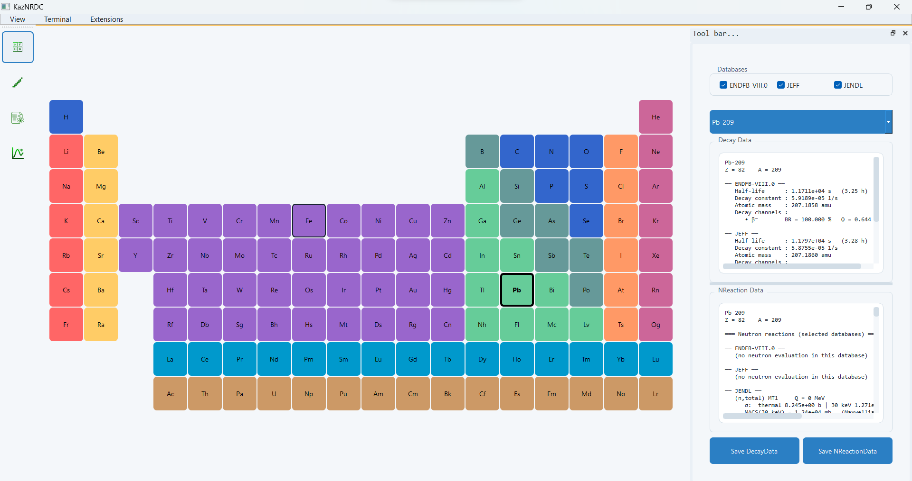

# Nuclear data registry

Select an element and isotope to inspect decay and neutron reaction data. Use the two information panes to compare sources, lifetimes and channels. Displayed source data do not by themselves confirm that a channel is enabled in the working burnup matrix.

Check the selected isotope's ground or metastable state as well as its element and mass number. Inspect a few known records before assembling a large network. Library choices and data installation are described in [Nuclear data setup](../nuclear-data.md).
