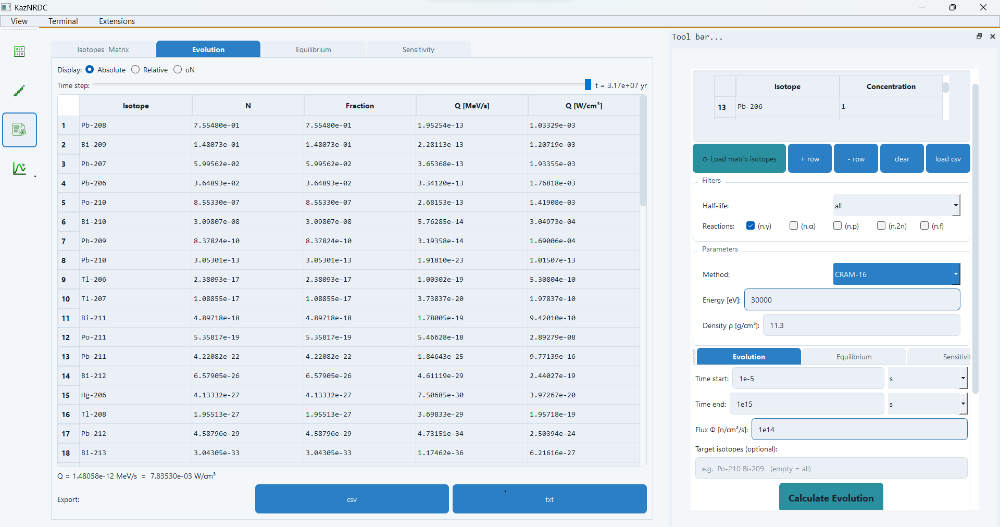

# Results workspace

## Isotopes and matrix

The main table contains isotope properties and transition information. It is not the complete numeric square matrix A. Use **Ctrl+F** to find/filter isotopes. Copy exports selected cells (or visible data when no cells are selected); the table CSV export contains isotope properties. Numerical matrix export is available through the core API.

Use the generic isotope input and **Add** to extend membership. Remove selected isotopes when appropriate. Isotopes referenced by manual channels can be protected or reintroduced so those transitions remain well-defined.

Use **Refresh Matrix View** after changing matrix settings. The preview's flux and the Evolution flux are separate controls. Data edits in a display table should not be treated as confirmed rate overrides; use the user database or manual decay editor and verify the resulting matrix.

### Decay types and half-lives

Select only the decay types and neutron MT channels required by your model. Disabling a decay does not imply deleting its parent isotope. The half-life presets keep eligible decays with half-life no greater than the selected threshold:

| Preset | Upper half-life, seconds |
|---|---:|
| all | No bound |
| yearly | 31,560,000 |
| daily | 86,400 |
| hourly | 3,600 |
| minute | 60 |
| second | 1 |

These are filters, not numerical integration steps. Excluding a physically relevant long-lived branch changes the model. Check boundary settings before using conservation as a diagnostic.

### Manual decay channels

Enter parent, daughter, mode, half-life in seconds and branch fraction in the manual-channel editor. A blank daughter represents a sink. Add the row and refresh the matrix. Manual transitions bypass global decay filters and replace matching evaluated branches. The generic mechanism can enable a selected alpha branch while other alpha channels remain disabled; there is no isotope-specific shortcut.

Validate the daughter, mass/charge change, branch fraction and lifetime yourself. If no matching evaluated energy is available, the manual channel may not contribute a known heat value.

## Evolution

Initial inventories may be entered manually or loaded from the supported two-column CSV. A direct reload of matrix isotopes into Initial Conditions can reset entries; check them before running.

Choose flux in neutrons/cm²/s or neutron density in neutrons/cm³. The density option converts through the entered energy; see [Methods](../methods.md). Set the irradiation endpoint in seconds and choose a solver appropriate to the calculation. The GUI provides ordinary CRAM-16, adaptive CRAM-16, CRAM-48, and Padé. Compare results and inspect diagnostics rather than assuming that successful completion guarantees accuracy; see [Solvers](../methods.md#solver-and-time-grid).

Targets can restrict the source-to-target calculation network. Leave the field empty for the full selected workspace. Inspect the resulting isotope list rather than treating Targets as only a visual filter.

Time step selects a saved time, normally among 400 outputs. The Evolution table shows individual isotope values and mass-number totals. Absolute preserves input units, Relative normalizes by the inventory total, and sigma N weights with capture cross sections. The extra A/N(A) rows group isotopes by mass number, not by chemical element.

CSV/TXT Evolution exports contain times, isotope inventories, fractions and mass-number summaries. They use their export-defined columns; changing a display mode does not necessarily change these files into sigma N exports. Read the header.

## Equilibrium

Configure the flux grid, initial composition, energy and either automatic plateau search or explicit evaluation times. Each flux is a separate calculation with the initial inventory. A flux sweep is not sequential irradiation with a changing flux.

Inspect returned times and inventories before calling a result equilibrium. Export its table and use the equilibrium graph types. Boundary losses and search limits can prevent a meaningful nonzero plateau.

## Sensitivity

Choose a concentration or heat target, fixed evaluation time or plateau, perturbation size and parameter types. The available scans cover cross sections, decay constants, flux/energy and library selection. Start with a limited scope; each perturbation requires another solve.

Inspect the baseline and rank by absolute sensitivity. A positive/negative sign describes the local target response, not whether a reaction is useful or harmful. Library deviations depend on the chosen reference and fallbacks. Verify configuration independently of the Evolution tab; not all manual overrides and filters are shared.

## What to save

Record the initial vector and calculation settings, inspect the isotope list and final total, and save a session before replacing the run. [Trajectory averaging](averaging.md) operates on this saved numerical trajectory. Changing the visible solver selection alone does not recalculate it.
